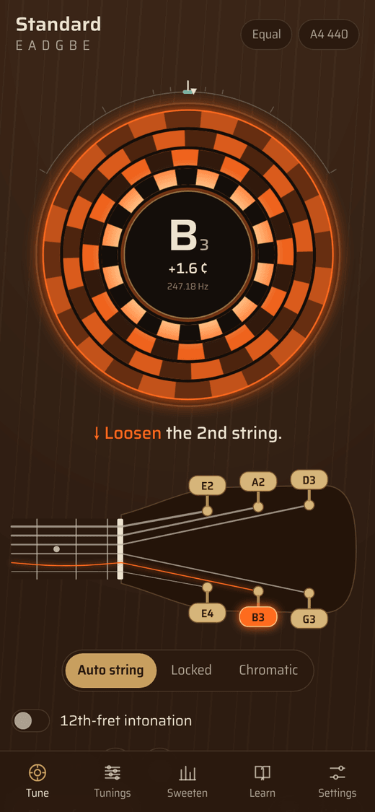
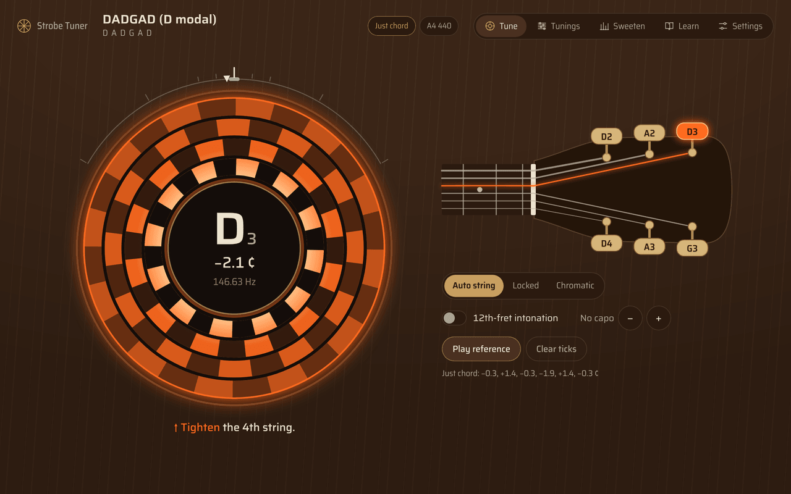
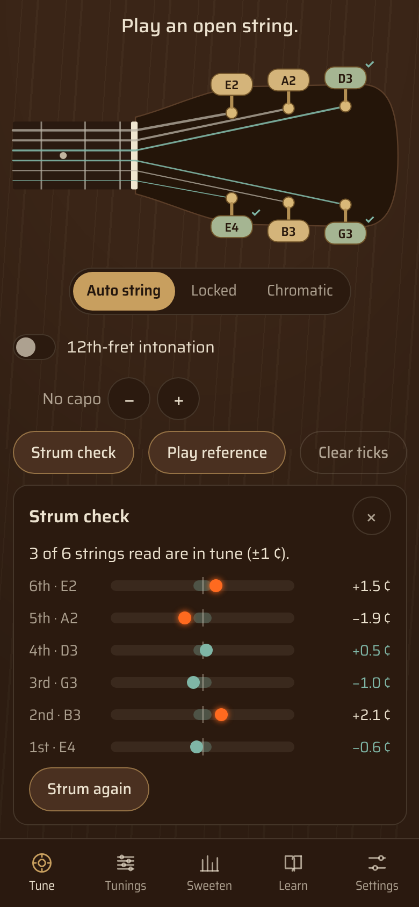
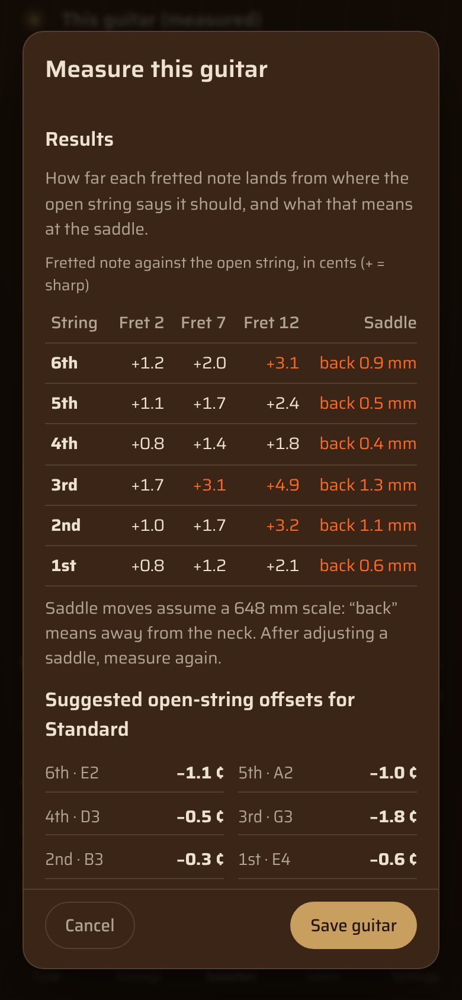

# Strobe Tuner — guitar tuner with sweetened tunings

A true-strobe guitar tuner for the web, Android and iOS, modelled on the features of Peterson's StroboPLUS HDC and Strobe Center 5000-II: a strobe disc that stands still when the string is in tune, sweetened tunings, historical temperaments, and automatic recognition of which of the six strings you are playing. It ships with a library of 35 standard, drop, open, modal, slack-key, regular and songwriter tunings, each explained and sourced from published research.

<p>
  
  
</p>

## Features

- **True strobe display.** Four rings follow the fundamental and the 2nd–4th harmonics. Clockwise means sharp, anticlockwise flat, and the speed is the error. The reading comes from heterodyning against the target (like a spinning strobe disc), not from FFT bins.
- **Six-string recognition.** Pluck any open string: the app finds which string it is, highlights its tuner on a 3+3 or 6-in-line headstock, tells you to tighten or loosen, and ticks each string off once it holds steady. Tap a tuner to lock that string.
- **Strum check you can tune from.** Strum all six strings once: the app reads every string from the single chord — any tuning, not just standard and drop — and tells you, per string, which way to turn and roughly how far. Then pluck any string and its row follows live; tap a row to lock the tuner on it, or press *Guide me* to be taken through each string that needs work, low to high, ending with a reminder to strum again (tuning one string shifts the neck tension). Strings whose overtones collide with another string's are marked *pluck alone* instead of guessed.
- **Fit this guitar.** Every guitar's compensation is different. Four strums (open strings, then a barre at frets 2, 7 and 12) measure this guitar's fretting error on every string, give saddle advice in millimetres, and compute the open-string offsets that suit this instrument in the current tuning — from "match other instruments" to "sweetest chords", using its own measured overtones. Save several guitars.
- **Sweetened tunings.** Just-chord sweetener for open and modal tunings, a least-squares open-chord fit for standard shapes, a measured strobe-style "GTR" preset, and fully custom open-string plus 12th-fret offsets (the Buzz Feiten structure). A sweetness control sets how far each moves from equal temperament.
- **Temperaments.** Equal, Pythagorean, just major, ¼-comma meantone, Werckmeister III, Kirnberger III, Young II and Kellner in any key — the Strobe Center 5000-II set, computed from their definitions.
- **Tuning library.** 35 tunings in eight families with interval maps, history and citations; make and save your own.
- **Six languages.** English, 繁體中文, 日本語, 한국어, Español and Deutsch, chosen from the browser or in Settings. A *Special terms* switch shows tuning names, temperaments and technical words (strobe, capo, cents…) translated, in the original, or both side by side — and decides whether note and interval names follow local custom (Do Re Mi in Spanish, H for B in German, 純四度 / 完全4度 / 완전4도 for P4).
- **Also:** A4 350–550 Hz, ±50 ¢ global offset, capo 0–9, chromatic mode, 12th-fret intonation mode with saddle directions, reference tone, four strobe colours, walnut and daylight panels, left-handed headstock, works offline.

<p>
  
  
</p>

## Use it

**Web.** Any static host works; the microphone needs https or `localhost`.

```bash
npm start            # zero-dependency server at http://localhost:8080
```

**Live site:** <https://jonwenjen.github.io/Guitar_Tunner/> — published from `main` by the **Publish web app** workflow on every push that changes `www/`. (One-time setup: Settings → Pages → Source: GitHub Actions.) The site installs as an app (PWA) and works offline.

**Android app:** on your phone, download <https://github.com/jonwenjen/Guitar_Tunner/releases/latest/download/strobe-tuner.apk>, open it and allow installing from this source. It is a test build signed with the public key in `ci/`; newer versions install over older ones.

**Android and iOS builds.** The same `www/` folder is wrapped with [Capacitor](https://capacitorjs.com/) 8. Every push to `main` builds them in GitHub Actions:

- **Android APK** workflow → a new GitHub Release with `strobe-tuner.apk` (the three newest are kept), plus a run artifact.
- **iOS simulator build** workflow → artifact `strobe-tuner-ios-simulator` (unsigned; drag `App.app` onto a running simulator).

Build locally:

```bash
npm install
npm run android:add      # creates android/ and adds RECORD_AUDIO permission
npm run ios:add          # creates ios/ (Swift Package Manager) and adds the microphone usage text
npm run native:assets    # app icons and splash from assets/
npm run sync             # copy www/ into both projects after edits
npm run android:open     # Android Studio → Run
npm run ios:open         # Xcode → choose your team under Signing → Run
```

Store builds need your own signing: a keystore for Google Play and an Apple Developer team for the App Store.

## How it measures

1. **Which note, which string** — McLeod Pitch Method (normalised square difference function via FFT) on 4096-sample windows, about 30 times a second, then nearest-target matching with hysteresis.
2. **How far off** — complex heterodyne at the target frequency and its harmonics, low-passed; the slope of the phase over 0.35 s is the beat frequency. Only the band around the fundamental is used, so stiff-string inharmonicity does not bias the reading.

On synthetic stiff plucked strings the strobe readout stays within ±0.02 ¢ of the true fundamental, while whole-waveform autocorrelation reads 0.3–2 ¢ sharp. Run `npm run accuracy` for the table. Real-world precision is limited by the microphone, room noise and the pitch drift of a decaying string.

## Research

- [docs/RESEARCH.md](docs/RESEARCH.md) — Peterson feature comparison, measurement method and accuracy, sweetener derivations, temperaments, literature review, better ways to tune (research survey), the Fit-this-guitar method and its accuracy, references.
- [docs/TUNINGS.md](docs/TUNINGS.md) — every tuning with notes, intervals, frequencies, sweetener values and sources (generated by `node scripts/gen-tunings-doc.mjs`).

Key sources: Varieschi & Gower (2010) on fretted-string intonation; Giordano (2015), Hinrichsen (2012) and Jaatinen & Pätynen (2022) on tuning to an instrument's real overtones; Barbancho et al. (2012) and US Patent 9,076,416 on reading strings from one strum; Mottola (2017, 2018) on how much compensation differences can be heard; Fletcher (1964) on string stiffness; Barbour (1951) on temperaments; Sethares' *Alternate Tuning Guide*; Griewank (2010) and Anderson et al. (2015) on major-thirds tuning; Winston's slack-key chart; Villegas et al. (2010) and Leimu (2017) on listener preference.

## Project layout

```
www/                 the app (plain ES modules, no build step)
  js/pitch.js          McLeod Pitch Method
  js/strobe-engine.js  heterodyne strobe
  js/strobe-view.js    strobe disc drawing
  js/tuner-core.js     string targets, string recognition, tuned ticks
  js/sweeteners.js     sweetened tunings
  js/poly.js           one-strum analysis of all six strings (partial collision map, f0 + inharmonicity fit)
  js/strum-capture.js  onset-triggered capture of a strum from the live input
  js/guitar-fit.js     fretting-error model, saddle advice, per-guitar offset optimiser
  js/fit-ui.js         strum check rows and the "Measure a guitar" wizard
  js/temperaments.js   historical temperaments
  js/tunings.js        tuning library
  js/headstock.js      headstock diagram
  js/i18n.js           languages, special-term modes, localized note and interval names
  locales/             en, zh-TW, ja, ko, es, de
tests/               node:test suites and synthetic string generator
scripts/             local server, icon builder, native permission patcher, docs generator
assets/              icon and splash sources for the native apps
.github/workflows/   tests, Android APK, iOS simulator build, GitHub Pages
```

## Tests

```bash
npm test             # 50 tests: detection on every string, strobe accuracy, string ID in all 35 tunings,
                     # temperament tables, sweetener values, targets with capo/A4/sweeteners, one-strum
                     # readings (standard, drop, open, barre, muted), the guitar-fit model and optimiser,
                     # and that every language translates every string in all term modes
```

## Notes

Strobe Tuner is independent and not affiliated with Peterson Electro-Musical Products; "StroboPLUS", "Strobe Center" and "Sweetened Tunings" are Peterson's names, used here only to describe the reference features. The "GTR"-style preset uses offsets measured and published by guitarists, not Peterson's data. The Saira typeface and the accidentals from Noto Music are used under the SIL Open Font License (`www/fonts/`).
